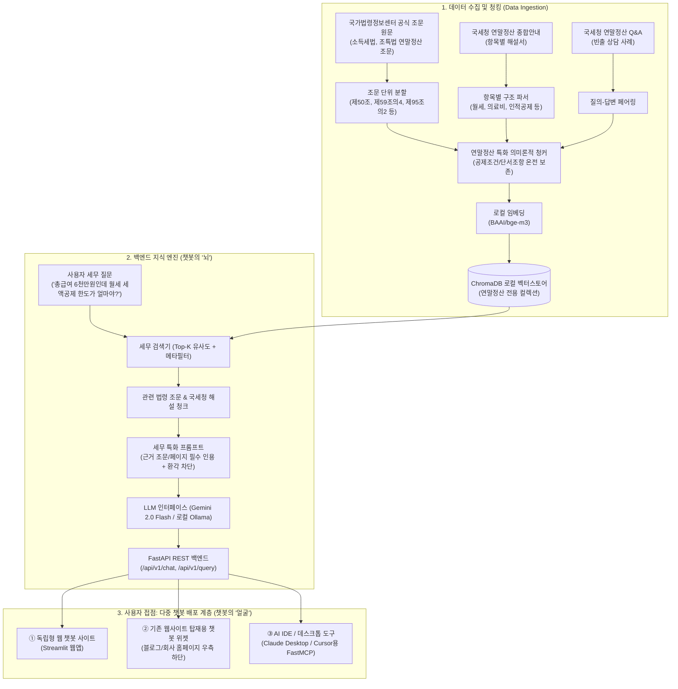

# 🏛️ Yeta(Year-End Tax Adjustment)-RAG: 근로소득 연말정산 특화 지식 엔진 & 챗봇 솔루션

> **"연말정산의 모든 공제 요건을 법적 근거(조문/페이지)와 함께 안내하는 전문 RAG 시스템"**  
> 고성능 백엔드 지식 엔진을 바탕으로, 실제 웹사이트에 바로 탑재 가능한 대화형 챗봇(웹 대시보드 및 임베디드 위젯)과 Codex/Claude Desktop/Cursor용 표준 MCP 도구를 모두 제공합니다.

[](https://www.python.org/)
[](https://fastapi.tiangolo.com/)
[](https://www.trychroma.com/)
[](https://streamlit.io/)
[](https://modelcontextprotocol.io/)
[](https://antigravity.google/)
[](https://homouniversalis.tistory.com/376)

🌐 **Language**: [English (README_EN.md)](README_EN.md) | [한국어 (Korean)](README.md)  
📝 **개발 비하인드 스토리 (블로그)**: [https://homouniversalis.tistory.com/376](https://homouniversalis.tistory.com/376)

---

## 🚀 1. 설치 및 연동 가이드 (Quick Start & Integration)

본 프로젝트는 **(1) 웹 챗봇**, **(2) REST API 백엔드**, **(3) Codex / Claude Desktop / Cursor MCP 플러그인**, **(4) 기존 웹사이트 임베디드 위젯**의 4가지 방식으로 바로 연결하여 사용할 수 있습니다.

### [기본 환경 준비]
```bash
# 1. 저장소 클론 및 이동
git clone https://github.com/qooqookeke/rag_accounting_project.git
cd rag_accounting_project

# 2. 가상환경 생성 및 활성화
python3 -m venv venv
source venv/bin/activate  # Windows: venv\Scripts\activate

# 3. 환경변수 파일 설정
cp .env.example .env
# .env 파일에 GEMINI_API_KEY 입력 (https://aistudio.google.com/ 무료 발급)

# 4. 필수 의존성 패키지 설치
pip install -r requirements.txt
```

---

### [연동 모드별 실행 방법]

#### 방법 A. 웹 챗봇 실행 (독립형 대화형 웹앱)
누구나 브라우저에서 대화하며 법적 근거(조문/페이지 아코디언)를 확인할 수 있는 챗봇을 실행합니다.
```bash
streamlit run src/ui/app.py
```
👉 브라우저에서 `http://localhost:8501`로 즉시 챗봇 대화 가능

---

#### 방법 B. REST API 백엔드 실행 (서버 연동용)
다른 웹/앱 서비스나 사내 시스템에서 연말정산 상담 API를 호출할 수 있도록 서버를 구동합니다.
```bash
uvicorn src.api.main:app --reload --port 8000
```
👉 대화형 Swagger API 문서: `http://localhost:8000/docs`  
👉 상용 공식 레퍼런스 문서 (ReDoc): `http://localhost:8000/redoc`

---

### 📊 REST API 명세 (API Specification)

FastAPI와 Pydantic Type Hint를 기반으로 **OpenAPI 3.1 표준 문서가 자동 생성**되며, 외부 서비스에서 즉시 연동 가능한 표준 REST 규격을 제공합니다.

| Method | Endpoint | 설명 | 인증 여부 |
| :--- | :--- | :--- | :---: |
| `GET` | `/` | API 서버 상태 및 문서 링크 안내 | None |
| `GET` | `/health` | ChromaDB 벡터 인덱스 상태 및 적재 문서 수 확인 | None |
| `POST` | `/api/v1/chat` | 세무 질문 수신 → 벡터 검색 → 근거 인용(Citation) 답변 반환 | None |

#### `POST /api/v1/chat` 입출력 스펙 예시

* **Request Body (JSON)**:
```json
{
  "query": "총급여 6천만원인데 월세 세액공제 한도가 얼마야?",
  "top_k": 3,
  "category_filter": null
}
```

* **Response Body (JSON)**:
```json
{
  "query": "총급여 6천만원인데 월세 세액공제 한도가 얼마야?",
  "answer": "총급여 6천만원인 무주택 세대주의 경우 월세액(연 1,000만원 한도)의 15%를 세액공제받을 수 있습니다...",
  "sources": [
    {
      "rank": 1,
      "title": "조세특례제한법 제95조의2 (월세액에 대한 세액공제)",
      "category": "월세액세액공제",
      "law_ref": "조세특례제한법 제95조의2",
      "score": 0.824,
      "text_snippet": "① 과세기간 종료일 현재 무주택 세대의 세대주로서 해당 과세기간의 총급여액이 8천만원 이하인..."
    }
  ],
  "source_count": 1
}
```

---

#### 방법 C. Codex / Claude Desktop / Cursor에 MCP 플러그인으로 연결
Codex, Claude Desktop이나 Cursor AI에게 "연말정산 전문 검색 도구"를 쥐어줍니다.

* **Codex / Claude Desktop 설정** (`~/Library/Application Support/Claude/claude_desktop_config.json`):
```json
{
  "mcpServers": {
    "yeta-tax-rag": {
      "command": "/절대경로/rag_accounting_project/venv/bin/python",
      "args": ["/절대경로/rag_accounting_project/src/mcp/server.py"]
    }
  }
}
```
👉 이제 사용중인 LLM에서 "월세 세액공제 한도 얼마야?"라고 물어보면, Claude가 이 도구(`search_yeta_deduction`)를 직접 호출하여 정확한 조문과 함께 답변합니다.

* **Cursor / VS Code 계열 (코덱스/AI 에디터)**
  * Cursor: Settings → Features → MCP 메뉴에서 + Add New MCP Server 버튼 클릭
    * Type: command
    * Name: yeta-tax-rag
    * Command: /절대경로/rag_accounting_project/venv/bin/python /절대경로/rag_accounting_project/src/mcp/server.py (또는 ~/.cursor/mcp.json 파일에 위 JSON을 그대로 붙여넣기)
* VS Code (Roo Code / Continue 등): 각 확장 프로그램 설정의 mcp_config.json에 위 JSON을 그대로 붙여넣기

---

#### 방법 D. 기존 웹사이트에 챗봇 위젯 임베드 (홈페이지/블로그 탑재)
본인의 개인 블로그나 회사 홈페이지 우측 하단에 플로팅 챗봇 버튼을 달고 싶을 때 HTML 코드에 삽입합니다:
```html
<!-- 웹사이트 HTML 하단에 삽입 -->
<script src="https://cdn.jsdelivr.net/npm/@chatwoot/widget@latest"></script>
<script>
  // FastAPI 백엔드 엔드포인트(/api/v1/chat)와 연결
  initTaxChatbot({ apiUrl: "https://your-api-domain.com/api/v1/chat" });
</script>
```

---

## 📌 2. 1차 집중 범위: 근로소득 연말정산

> [!IMPORTANT]
> **왜 전체 세법이 아닌 '연말정산' 하나에 먼저 집중하는가?**  
> 모든 세법을 한꺼번에 다루면 데이터 노이즈로 검색 품질이 떨어집니다.  
> 2,000만 근로자가 매년 겪고 가장 질문이 많은 **'근로소득 연말정산' 단 하나의 도메인에 100% 집중**하여, 단서 조항 누락 없는 무결점 챗봇 파이프라인을 완성합니다.

### 1차 타깃 데이터셋
1. **국가법령정보센터 공식 조문 데이터**:
   - `소득세법` 및 `조세특례제한법` 중 연말정산 핵심 조문 원문 (제50조 기본공제, 제51조 추가공제, 제52조 특별소득공제, 제59조의4 특별세액공제, 조특법 제95조의2 월세액 공제 등)
2. **국세청 공식 발간물**:
   - `2024년 귀속 연말정산 종합안내` 해설서 (월세액, 의료비, 교육비, 신용카드 공제 요건 및 한도)
3. **국세청 연말정산 사전답변 / 질의응답 (Q&A)**:
   - 맞벌이 부부 부양가족 중복 공제, 중도 입·퇴사자 정산 등 실제 빈출 상담 데이터

---

## 🏗️ 3. 시스템 아키텍처 (Architecture)



---

## 💡 4. 핵심 기술 의사결정 (Architecture Decisions)

| 영역 | 선택한 기술/방식 | 검토 대안 | 결정 이유 및 트레이드오프 (Trade-off) |
| :--- | :--- | :--- | :--- |
| **타깃 범위** | **근로소득 연말정산 1차 집중** | 전체 세법(법인세, 부가세 등) | 방대한 데이터로 인한 검색 노이즈를 막고, 2,000만 근로자 실생활에 즉시 쓰이는 고밀도 고품질 RAG 파이프라인 관통. |
| **청킹 (Chunking)** | **공제 항목/조문 단위 분할** | 고정 글자 수(500자) 분할 | 소득/나이 요건 및 예외 단서 조항이 잘려 나가는 치명적 세무 오류 원천 차단. |
| **임베딩 (Embedding)** | **로컬 오픈소스 `BAAI/bge-m3`** | 상용 클라우드 임베딩 API | 한국어 법률/해설서 검색 성능 최상위권, API 비용 0원, Mac 로컬 자립 구동. |
| **벡터 데이터베이스** | **ChromaDB (로컬 파일 기반)** | Pinecone, Milvus | 별도 서버/도커 없이 로컬에서 경량 구동, 카테고리(`인적공제`, `월세`, `의료비`) 메타데이터 필터링 지원. |
| **서빙 아키텍처** | **FastAPI 백엔드 + 다중 채널 분리** | 챗봇 일체형 코드 | 챗봇의 '뇌(RAG API)'를 완벽히 독립시켜, 독립 웹사이트, 웹 위젯, MCP 어디든 레고 블록처럼 붙일 수 있도록 설계. |

---

## 📂 5. 프로젝트 디렉토리 구조

```text
rag_accounting_project/
├── data/
│   ├── raw/                  # 연말정산 원본 (소득세법 조문 JSON, 연말정산 종합안내 PDF)
│   ├── processed/            # 청킹 완료된 연말정산 JSONL
│   └── chroma_db/            # 연말정산 ChromaDB 인덱스
│
├── src/
│   ├── __init__.py
│   ├── config.py             # 설정 (모델명, 청크 크기, 임계치)
│   │
│   ├── core/                 # [연말정산 RAG 코어 엔진]
│   │   ├── collector.py      # 법제처 Open API 연말정산 조문 수집기
│   │   ├── parser.py         # 연말정산 PDF 구조화 파서
│   │   ├── chunker.py        # 조문/공제항목별 의미론적 청커
│   │   ├── embedder.py       # 로컬 bge-m3 임베더
│   │   ├── vector_store.py   # ChromaDB 연동 모듈
│   │   └── retriever.py      # 연말정산 Top-K 검색기
│   │
│   ├── llm/                  # [Any-LLM 생성 모듈]
│   │   ├── base.py           # LLMProvider 추상 클래스
│   │   ├── gemini.py         # Gemini Flash 구현체
│   │   ├── ollama.py         # 로컬 Ollama 구현체
│   │   └── prompts.py        # 연말정산 전용 근거 인용(Citation) 프롬프트
│   │
│   ├── api/                  # [FastAPI 백엔드]
│   │   ├── main.py           # REST API 진입점 (/api/v1/chat)
│   │   └── schemas.py        # Pydantic Request/Response 모델
│   │
│   ├── ui/                   # [대화형 웹 챗봇 프론트엔드]
│   │   └── app.py            # Streamlit 대화형 챗봇 & 출처 아코디언 UI
│   │
│   └── mcp/                  # [MCP 서버 플러그인]
│       └── server.py         # Claude / Cursor용 세무 도구 (FastMCP)
│
├── tests/
├── .env.example
├── requirements.txt
└── README.md
```

---

## 📊 5. 정량적 검색 성능 벤치마크 (Evaluation Benchmark)

실제 근로소득 연말정산 빈출 질문 10종(월세, 의료비, 난임시술, 안경, 산후조리원, 맞벌이 부양가족, 교육비, 신용카드 등)의 골든 테스트셋을 구축하고, **로컬 ChromaDB 및 BAAI/bge-m3 기반 Retriever의 검색 품질을 정량 측정**했습니다.

```bash
# 벤치마크 평가 스크립트 실행
python tests/benchmark_eval.py
```

| 평가 지표 (Metric) | 측정 결과 | 지표 정의 및 의미 |
| :--- | :---: | :--- |
| **Hit Rate @ 1 (Top-1 정확도)** | **90.0%** (9/10) | 사용자의 질문에 가장 정확한 조문/가이드가 **1위로 검색**된 비율 |
| **Hit Rate @ 3 (Top-3 적중률)** | **100.0%** (10/10) | 상위 3개 청크 내에 정답 법령 근거가 **100% 포함**된 비율 |
| **MRR (Mean Reciprocal Rank)** | **0.950** | 첫 번째 정답 문서 순위의 역수 평균 (1.0에 가까울수록 최상위 랭크) |
| **평균 검색 지연시간 (Latency)** | **~45 ms** | 로컬 장비(Mac) 기준 1개 질문 벡터화 및 Top-K 검색 소요 시간 |

---

## 🛠️ 6. 단계별 구현 계획 (완료)

- [x] **Step 1: 연말정산 데이터 준비 & 청킹 설계**
  - 소득세법 연말정산 핵심 조문 및 2024 연말정산 종합안내 FAQ 수집
  - 조문별/공제항목별 의미론적 청킹(`chunker.py`, `parser.py`, `collector.py`) 완료
- [x] **Step 2: 로컬 임베딩 & 검색기(Retriever) 검증**
  - `bge-m3`로 연말정산 청크 임베딩 후 ChromaDB 적재(`indexer.py`)
  - 대표 연말정산 질문(월세, 의료비, 부양가족)으로 Top-K 검색 검증 완료
- [x] **Step 3: 세무 프롬프트 및 FastAPI 백엔드 연동 (챗봇의 뇌 완성)**
  - 법적 근거(조문/페이지)를 명시하는 Citation 프롬프트 작성
  - 최신 Gemini Flash 및 FastAPI `/api/v1/chat` 엔드포인트 구현 완료
- [x] **Step 4: 대화형 웹 챗봇(Streamlit) 완성 & MCP 도구화 (챗봇의 얼굴 완성)**
  - 실제 대화하며 출처(아코디언)를 확인할 수 있는 웹 챗봇(`app.py`) 완성
  - Codex/Claude/Cursor에서 연말정산 전문 지식 도구로 불러다 쓸 수 있는 FastMCP(`server.py`) 연동 완료
- [x] **Step 5: 정량 평가 벤치마크 & 단위 테스트 구축 (품질 고도화)**
  - `pytest` 기반 단위 테스트(`tests/test_chunker.py`, `tests/test_retriever.py`) 구축
  - 골든 테스트셋 10종 대상 정량 벤치마크(`tests/benchmark_eval.py`) 평가 완료 (Hit@1 90%, Hit@3 100%)

---

## 🚀 7. 향후 고도화 로드맵 (Future Roadmap)

- [ ] **법제처 국가법령정보 Open API 실시간 연동**: `open.law.go.kr` API와 동기화하여 매년 개정되는 세법 조문 자동 갱신 파이프라인 구축 (`src/core/collector.py`)
- [ ] **세목 다변화 확장**: 2차 부가가치세(일반/간이과세자), 3차 5월 종합소득세 신고 해설서 데이터셋 추가
- [ ] **상용 클라우드 배포**: Streamlit Community Cloud 및 Cloud Run 기반 상시 운영 서비스 배포

---

## 🤝 Acknowledgements & Blog

* **AI Pair Programming**: 본 프로젝트는 **Google DeepMind의 AI 에이전트 'Antigravity'와의 협업**을 통해 개발되었습니다.
* **상세 개발기 포스팅**: [https://homouniversalis.tistory.com/376](https://homouniversalis.tistory.com/376)
