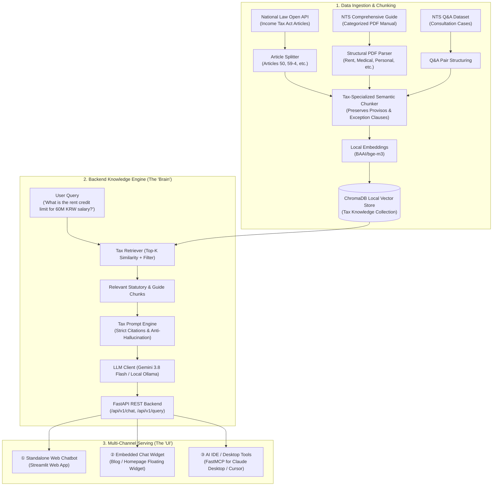

# 🏛️ Yeta-RAG: Specialized Knowledge Engine & Chatbot for Year-End Tax Settlement

> **"A specialized RAG system providing every deduction criteria along with legal references (articles/pages)"**  
> Powered by a high-performance backend knowledge engine, Yeta-RAG provides a conversational web chatbot (standalone dashboard & embeddable widget) and standard MCP tools for Codex, Claude Desktop, and Cursor.

[](https://www.python.org/)
[](https://fastapi.tiangolo.com/)
[](https://www.trychroma.com/)
[](https://streamlit.io/)
[](https://modelcontextprotocol.io/)

[한국어 README (Korean)](README.md)

---

## 🚀 1. Quick Start & Integration Guide

Yeta-RAG supports 4 integration modes: **(1) Web Chatbot**, **(2) REST API Backend**, **(3) Codex / Claude Desktop / Cursor MCP Plugin**, and **(4) Embeddable Web Widget**.

### [Prerequisites & Setup]
```bash
# 1. Clone the repository and navigate into it
git clone https://github.com/qooqookeke/rag_accounting_project.git
cd rag_accounting_project

# 2. Create and activate a virtual environment
python3 -m venv venv
source venv/bin/activate  # Windows: venv\Scripts\activate

# 3. Configure environment variables
cp .env.example .env
# Set your GEMINI_API_KEY in .env (Free key available at https://aistudio.google.com/)

# 4. Install dependencies
pip install -r requirements.txt
```

---

### [Running by Integration Mode]

#### Mode A. Standalone Web Chatbot
Launch an interactive chatbot where users can ask questions and inspect legal citations (articles/pages accordion).
```bash
streamlit run src/ui/app.py
```
👉 Access the chatbot immediately in your browser at `http://localhost:8501`.

---

#### Mode B. REST API Backend (Server Integration)
Run the backend server so external web/mobile apps or intranet systems can call the tax advisory API.
```bash
uvicorn src.api.main:app --reload --port 8000
```
👉 Interactive Swagger API Docs: `http://localhost:8000/docs`  
👉 Enterprise Reference Docs (ReDoc): `http://localhost:8000/redoc`

---

### 📊 REST API Specification

OpenAPI 3.1 standard documentation is **automatically generated** via FastAPI and Pydantic Type Hints.

| Method | Endpoint | Description | Auth |
| :--- | :--- | :--- | :---: |
| `GET` | `/` | API server status & documentation links | None |
| `GET` | `/health` | ChromaDB vector index status & document count | None |
| `POST` | `/api/v1/chat` | Receive tax question → Vector search → Return response with citations | None |

#### `POST /api/v1/chat` I/O Example

* **Request Body (JSON)**:
```json
{
  "query": "What is the deduction limit for monthly rent if my annual salary is 60 million KRW?",
  "top_k": 3,
  "category_filter": null
}
```

* **Response Body (JSON)**:
```json
{
  "query": "What is the deduction limit for monthly rent if my annual salary is 60 million KRW?",
  "answer": "For a householder without a home earning 60 million KRW annually, 15% of the monthly rent paid (up to 10 million KRW per year) is eligible for a tax credit...",
  "sources": [
    {
      "rank": 1,
      "title": "Restriction of Special Taxation Act Article 95-2 (Tax Credit for Monthly Rent)",
      "category": "월세액세액공제",
      "law_ref": "조세특례제한법 제95조의2",
      "score": 0.824,
      "text_snippet": "① In case of a resident having earned income whose total salary for the taxable period is not more than 80 million won..."
    }
  ],
  "source_count": 1
}
```

---

#### Mode C. Connect via MCP Plugin (Codex / Claude Desktop / Cursor)
Empower Codex, Claude Desktop, or Cursor AI with a dedicated **Year-End Tax Search Tool**.

* **Codex / Claude Desktop Configuration** (`~/Library/Application Support/Claude/claude_desktop_config.json`):
```json
{
  "mcpServers": {
    "yeta-tax-rag": {
      "command": "/absolute/path/to/rag_accounting_project/venv/bin/python",
      "args": ["/absolute/path/to/rag_accounting_project/src/mcp/server.py"]
    }
  }
}
```
👉 When asking questions like *"What is the rent credit limit?"*, the AI automatically calls `search_yeta_deduction` to provide answers with exact statutory references.

* **Cursor / VS Code (AI IDEs)**
  * **Cursor**: Go to `Settings` → `Features` → `MCP` → Click `+ Add New MCP Server`
    * Type: `command`
    * Name: `yeta-tax-rag`
    * Command: `/absolute/path/to/venv/bin/python /absolute/path/to/src/mcp/server.py` *(or add to `~/.cursor/mcp.json`)*
  * **VS Code (Roo Code / Continue, etc.)**: Paste the same JSON snippet into the extension's `mcp_config.json`.

---

#### Mode D. Embed Chatbot Widget into Existing Websites
Embed a floating chatbot button in the bottom-right corner of your personal blog or company homepage:
```html
<!-- Insert at the bottom of your website HTML -->
<script src="https://cdn.jsdelivr.net/npm/@chatwoot/widget@latest"></script>
<script>
  // Connect with FastAPI backend endpoint (/api/v1/chat)
  initTaxChatbot({ apiUrl: "https://your-api-domain.com/api/v1/chat" });
</script>
```

---

## 📌 2. Project Scope: Year-End Tax Settlement Focus

> [!IMPORTANT]
> **Why focus specifically on Year-End Tax Settlement first?**  
> Covering all corporate, value-added, and inheritance taxes at once introduces severe retrieval noise.  
> Focusing 100% on **earned income year-end tax settlement**—which impacts over 20 million workers annually—allows us to eliminate hallucination around statutory exceptions and build a production-grade, zero-defect RAG pipeline.

### Target Datasets
1. **National Law Information Center Open API (Ministry of Government Legislation)**:
   - Key articles from the `Income Tax Act` (Articles 50, 51, 52, 59-4, etc.)
2. **National Tax Service Official Publications**:
   - `2024 Year-End Tax Settlement Comprehensive Guide` PDF (Rent, Medical, Education, and Credit Card deductions)
3. **National Tax Service Advance Rulings & FAQs**:
   - High-frequency real-world Q&A (e.g., dual-income couple dependent deductions, job transfers)

---

## 🏗️ 3. System Architecture



---

## 💡 4. Architectural Decisions & Trade-offs

| Domain | Chosen Approach | Alternatives Considered | Rationale & Trade-offs |
| :--- | :--- | :--- | :--- |
| **Scope** | **100% Focus on Year-End Settlement** | All Tax Categories (Corporate, VAT) | Prevents noisy cross-tax retrieval; targets the most critical annual workflow for 20M+ workers. |
| **Chunking** | **Semantic Unit / Article Split** | Fixed Character Count (e.g., 500 chars) | Prevents breaking off critical legal provisos ("Provided, That..."), ensuring zero deduction errors. |
| **Embedding** | **Local Open-Source `BAAI/bge-m3`** | Cloud Embedding APIs | Top-tier Korean legal text search benchmarks, zero API costs, runs locally on Mac CPU/MPS. |
| **Vector DB** | **ChromaDB (Local File-Based)** | Pinecone, Milvus | Lightweight, serverless, no Docker required; native support for category metadata filtering. |
| **Serving** | **Decoupled FastAPI + Multi-Channel** | Monolithic Chatbot Code | Completely separates the RAG core from UI, allowing seamless embedding into web apps, widgets, or MCP tools. |

---

## 📂 5. Project Directory Structure

```text
rag_accounting_project/
├── data/
│   ├── raw/                  # Raw sources (Tax Law text, NTS Guide FAQ)
│   ├── processed/            # Processed/chunked JSONL
│   └── chroma_db/            # ChromaDB persistent vector index
│
├── src/
│   ├── __init__.py
│   ├── config.py             # Global configurations (paths, models, thresholds)
│   │
│   ├── core/                 # [Core RAG Engine]
│   │   ├── collector.py      # Law Open API collector
│   │   ├── parser.py         # Structural PDF parser
│   │   ├── chunker.py        # Semantic chunker by article/topic
│   │   ├── embedder.py       # Local bge-m3 embedder
│   │   ├── vector_store.py   # ChromaDB interface
│   │   └── retriever.py      # Top-K dense retriever
│   │
│   ├── llm/                  # [Any-LLM Module]
│   │   ├── base.py           # LLMProvider abstract interface
│   │   ├── client.py         # Gemini 3.8 Flash & Ollama client
│   │   └── prompts.py        # Strict citation system prompts
│   │
│   ├── api/                  # [FastAPI Backend]
│   │   ├── main.py           # REST API entrypoint (/api/v1/chat)
│   │   └── schemas.py        # Pydantic Request/Response models
│   │
│   ├── ui/                   # [Streamlit Web UI]
│   │   └── app.py            # Chatbot UI with citation accordions
│   │
│   └── mcp/                  # [MCP Plugin]
│       └── server.py         # MCP tool server for Codex, Cursor, Claude
│
├── tests/
├── .env.example
├── requirements.txt
├── README.md                 # Korean documentation
└── README_EN.md              # English documentation
```

---

## 🛠️ 6. Implementation Milestones (Completed)

- [x] **Step 1: Data Preparation & Semantic Chunking**
  - Collected core Income Tax Act articles & 2024 NTS FAQ dataset
  - Implemented semantic chunking preserving legal provisos (`chunker.py`)
- [x] **Step 2: Local Embeddings & Retriever Verification**
  - Embedded chunks via `bge-m3` and indexed into ChromaDB (`indexer.py`)
  - Verified Top-K retrieval precision for key deduction queries
- [x] **Step 3: Citation Prompts & FastAPI Backend**
  - Designed strict citation system prompt preventing hallucinations
  - Implemented Gemini 3.8 Flash client and `/api/v1/chat` endpoint with OpenAPI 3.1 docs
- [x] **Step 4: Interactive Web Chatbot & MCP Tooling**
  - Built Streamlit chatbot with collapsible citation accordions (`app.py`)
  - Implemented standard MCP tool server for Codex / Cursor / Claude Desktop (`server.py`)
- [x] **Step 5: Documentation & Production Readiness**
  - Completed OpenAPI specs, bilingual READMEs, and technical interview walkthroughs
